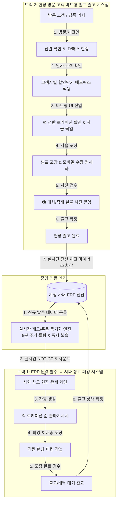

# 🛒 알트에프마트 (ALTF Mart) 종합 구현 설계서 (Implementation Plan)

> **프로젝트명**: 알트에프마트 (ALTF Mart)  
> **핵심 과업**: ERP 연동 출하지시/패킹 시스템 & 방문 고객 신원인증 기반 마트형 셀프 출고 시스템 구축  
> **동기화 목표**: 현장 출고 및 ERP 변경사항 5분 이내 실시간 전산 동기화  

---

## 🧭 1. 프로젝트 비전 및 시스템 구조도 (System Mindmap)



---

## 📦 2. 트랙별 세부 구현 사양 (Technical Specifications)

### 📌 [트랙 1] ERP 원격 발주 → 시화 창고 실시간 알림 & 패킹 시스템

#### 1.1 ERP 발주 수신 인바운드 어댑터 (ERP Inbound Adapter)
* **연동 방식**: 지정 ERP의 신규 발주 테이블/API를 모니터링 (Webhook 우선, 미지원 시 1~2분 주기 고속 Polling).
* **데이터 정규화 (Payload)**:
  * 주문번호, 발주일시, 거래처명, 납기일, 배송방식(화물/택배/직배/방문수령).
  * 품목 리스트: SKU, 품명, 규격, 두께, 재질, 발주수량, 납품단가.

#### 1.2 시화 창고 현장 관제 & 실시간 NOTICE 시스템
* **시각/청각 알림 (Sound & Visual Alert)**:
  * 주문 접수 시 창고 모니터 및 태블릿에 **"🚨 새로운 주문서가 접수되었습니다!"** 대형 팝업과 경보음 송출.
  * 미확인 주문서는 시각적 점멸(Blinking) 유지로 누락 방지.
* **스마트 출하지시서 (Smart Picking & Packing Slip)**:
  * 단순 품목 나열이 아닌, **창고 동선 최적화 랙 로케이션 순서(`A Zone → B Zone → C Zone`)**로 자동 정렬 출력.
  * 포장 단위(박스 수량 / 낱개 수량) 분리 명시.
    * *예: 25A 엘보 130개 발주 시 → [완박스(50개) 2박스 + 낱개 30개]*
* **현장 직원 패킹(Packing) 워크플로우**:
  * Step 1: 피킹 시작 (Picking In-Progress)
  * Step 2: 배달용 포장 및 라벨 부착 (Packaging)
  * Step 3: 패킹 완료 확인 (Packed & Ready) → ERP 상태 자동 연동.

---

### 📌 [트랙 2] 창고 방문 고객 신원 인증 & 마트형 셀프 출고 시스템

#### 2.1 신원 확인 및 억세스 제어 (Identity & Access Gate)
* **목적**: 무단 반출 방지, 신뢰 고객 검증, 전용 할인 요율 자동 매핑.
* **인증 수단 (Multi-Auth Options)**:
  * **Option A (모바일 패스/QR)**: 고객사 대표/기사 휴대폰으로 발급된 모바일 출입 QR 스캔.
  * **Option B (키오스크/단말기 인증)**: 사업자번호 뒤 4자리 + 기사 휴대전화 인증번호 입력.
  * **Option C (임시 방문증 교부)**: 현장 관리자가 즉석에서 1회용 마트 픽업 ID 발급.
* **접근 제어**: 승인되지 않은 미인증 인원은 단가 열람 및 출고 버튼이 잠김(Lock).

#### 2.2 고객사별 맞춤형 할인 단가 매트릭스 엔진
* 인증된 고객의 사업자 식별값(`customerId`)을 기반으로:
  * 기본 정가 / 기준 단가 열람 차단.
  * 해당 고객사 전용 **약정 할인 요율(할인단가)** 및 **공급가액**만 깔끔하게 노출.
  * 현장에서 마트처럼 단가를 확인하며 바로 담을 수 있는 투명한 구매 환경 제공.

#### 2.3 마트형 셀프 픽업 & 포장 인터페이스 (Mart Self-Checkout UI)
* **모바일/태블릿 최적화 마트 UI**:
  * 품목 검색 시 대형 사진과 함께 **랙 위치 배지(예: `A-02-3-01`)**를 큼직하게 안내.
  * 최소 보관단위 / 포장단위 안내 (예: "1박스=50개들이 / 낱개 픽업 가능").
* **셀프 포장 스테이션 (Self-Packing Station)**:
  * 마트 포장대처럼 밴딩기, 박스, 테이프가 구비된 작업대에서 고객이 직접 패킹.
* **📷 대차/카트 적재 실물 사진 촬영 (Proof of Pickup)**:
  * 출고 승인 직전, 스마트폰 카메라로 **적재된 카트/대차 실물 사진 촬영 필수(Mandatory)**.
  * 사진은 클라우드 및 주문 레코드에 영구 저장되어 오출고 분쟁 및 수량 확인 증빙으로 활용.

#### 2.4 1-Click ERP 즉시 차감 파이프라인
* 고객이 최종 [출고 확정] 버튼 클릭 시:
  * 1) 시화 창고 전산 재고(`sh_qty`) **즉시 마이너스(-) 차감**.
  * 2) 지정 ERP에 '현장 즉시 출고 전표' API 자동 전송.
  * 3) 고객 모바일 및 ERP에 전자 거래명세서 동시 발행.

---

## ⏱️ 3. 실시간 재고 전산 동기화 (5분 보장 엔진)

고객에게 보여지는 웹/모바일 재고와 실제 창고 및 ERP 재고 간의 오차를 없애기 위한 동기화 전략:

```text
[ 현장 마트 출고 발생 ] ──(초동 0초)──> [ 로컬 캐시 즉시 차감 & 락(Lock) ]
                                      │
[ ERP 재고 차감 요청 ] ──(10초 이내)──> [ ERP DB 반영 완료 ]
                                      │
[ 전 고객 화면 동기화 ] ──(최대 5분)──> [ 5분 주기 Full Revalidation ]
```

1. **낙관적 업데이트 (Optimistic Update)**:
   * 마트 현장에서 출고되는 순간 대기 시간 없이 즉시 해당 품목의 가용 재고를 차감하여 타 고객의 중복 구매 차단.
2. **5분 주기 하트비트 동기화 (5-Min Heartbeat Polling)**:
   * ERP의 변동된 실재고량을 최대 5분 주기로 전체 클라이언트에 전파.
   * 네트워크 유실이나 수기 ERP 변경 건도 최대 5분 이내에 완벽 일치 보장.

---

## 🛠️ 4. 단계별 구축 로드맵 (Actionable Milestones)

| 단계 | 과업명 | 주요 산출물 | 세부 개발 내용 |
|:---:|:---|:---|:---|
| **Phase 1** | **아이템 마스터 & 랙 주소 체계화** | `mart_master_data.json` | * 시화 재고 전 품목 랙 위치(`Zone-Bay-Tier-Bin`) 확정<br>* 구경별 포장단위(Box 입수량) 및 최소 보관단위 세분화 |
| **Phase 2** | **ERP 인바운드 & 시화 출하지시 시스템** | 시화 창고 관제 대시보드 (`/admin/sihwa-dispatch`) | * ERP 주문서 수신 어댑터 구축<br>* 접수 알림(팝업 & 오디오 알람)<br>* 로케이션 순 피킹/패킹 지시서 생성 |
| **Phase 3** | **마트형 고객 인증 & 셀프 픽업 UI** | 알트에프마트 웹앱 (`/mart`) | * 고객 신원확인(QR/사업자코드) 게이트웨이<br>* 고객사별 특별 할인단가 노출 엔진<br>* 랙 위치 기반 카트 담기 & 셀프 포장 가이드 |
| **Phase 4** | **사진 촬영 검수 & ERP 실시간 차감** | 카메라 연동 & 5분 동기화 엔진 | * 모바일 대차 사진 촬영 및 업로드 파이프라인<br>* 출고 즉시 ERP 재고 마이너스 차감 API<br>* 5분 주기 재고 정합성 엔진 가동 |

---

## 💡 5. 준비사항 및 대표님 확인 필요 사항

1. **연동 대상 ERP의 규격 확인**:
   * 현재 사용 중이신 사내 ERP(예: 영림원, 이카운트, 더존, 자체 DB 등)의 데이터 추출 방식 (DB Direct View, Webhook, API, 또는 주기적 엑셀/파일 연동 방식)
2. **창고 랙 현장 구획 기준**:
   * 시화 창고의 현재 랙 열(Bay) 개수 및 단수(Tier) 구조와 당사 표준 규격안의 일치 여부
3. **고객 인증 방식 선호도**:
   * 현장 방문 고객에게 모바일 링크(카카오 알림톡/QR) 방식과 현장 비치 태블릿 입력 방식 중 선호하시는 형태
